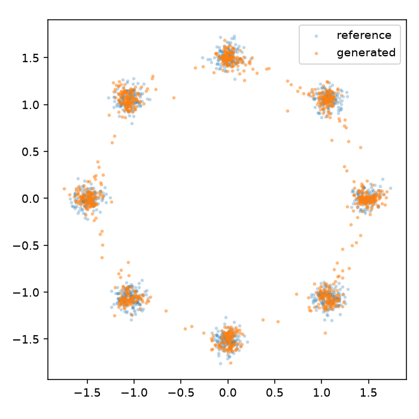
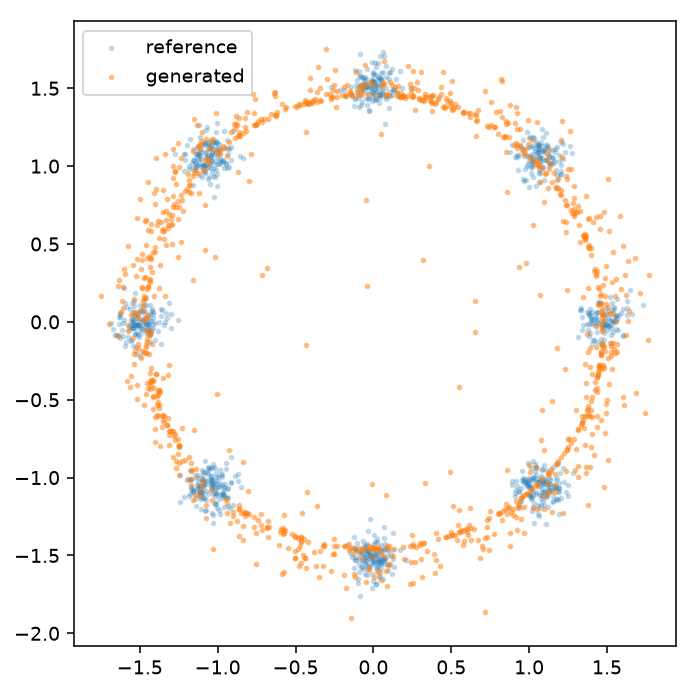

# xDiffusion

### Small generative models you can read, run, and compare.

**Diffusion · flow matching · Priming Models · VAE · GAN.**
Five objectives, explicit PyTorch code, and a curriculum from 2D points to images.

[](https://github.com/makdoudN/xDiffusion/actions/workflows/check.yml) [](pyproject.toml) [](pyproject.toml)

**[Get started](#get-started) · [Models](#five-ways-to-learn-a-distribution) · [Comparison](#compare-the-models) · [Image quality](#image-quality-and-reconstruction) · [Code](#read-the-code) · [The math](doc/families.md)**

<!-- current-gallery:start -->
<table>
  <tr><th>Diffusion · v prediction · 50,000 updates</th><th>Flow matching · 10,000 updates</th></tr>
  <tr>
    <td></td>
    <td></td>
  </tr>
</table>
<table>
  <tr><th>Priming · one evaluation</th><th>VAE · one decoder evaluation</th>
    <th>GAN · one generator evaluation</th></tr>
  <tr>
    <td></td>
    <td></td>
    <td></td>
  </tr>
</table>

The first diffusion gallery has a **larger training budget**. The fixed-budget
comparison below keeps every family at 10,000 updates.
<!-- current-gallery:end -->

These galleries show **unconditional generations**, using a fixed sampling seed
and no filtering. Actual input/reconstruction pairs are shown separately below.
All figures come from saved model outputs; the [comparison report](reports/comparison-2026-10-20/README.md)
records the settings, metrics, and limitations.

## Why this repo?

A 2D scatter plot makes missing modes and blurry boundaries visible. Digits then
show what changes when a model must learn spatial structure. Trying several
objectives on the same data makes their training and sampling trade-offs concrete.

In the spirit of [nanoGPT](https://github.com/karpathy/nanoGPT) and
[xByteGPT](https://github.com/makdoudN/xByteGPT), the goal is code small enough
to follow and experiments explicit enough to check.

- **Plain PyTorch.** Model definitions and objective equations live in small,
  separate modules; the comparison loop is ordinary Python.
- **Visible tensor contracts.** Jaxtyping names shapes and dtypes, einops names
  rearranged axes, and pytest checks the annotations at runtime.
- **Dataclasses become CLIs.** Tyro exposes flags such as `--model.width 32`
  and `--flow.steps 25`, without configuration inheritance.
- **Evidence beside examples.** Saved configs, learning histories, unfiltered
  grids, held-out scores, and independent feature encoders.

Single-device float32 training on **CPU or CUDA**. Python 3.12–3.13; `uv.lock`
pins dependencies, including a PyTorch/torchvision pair supporting the GTX 1080.

## Get started

Install [uv](https://docs.astral.sh/uv/getting-started/installation/), then:

```bash
git clone https://github.com/makdoudN/xDiffusion.git
cd xDiffusion
uv sync --locked

# Diffusion on eight Gaussian modes. No download required.
uv run -m xdiffusion.train
```

Open **`out/ring8/samples.png`**. Orange points are generated; blue points are
held-out references. The run saves its checkpoint and metrics alongside the plot.
CUDA is selected when available; otherwise training uses CPU.

```bash
# Sample and score the original diffusion CLI's checkpoint.
uv run -m xdiffusion.sample --checkpoint out/ring8/ckpt.pt
uv run -m xdiffusion.evaluate --checkpoint out/ring8/ckpt.pt

# A 20-step CPU installation check, not a trained-model result.
uv run -m xdiffusion.train --device cpu --steps 20 --model.width 32 \
  --sampling.samples 64 --out-dir out/smoke
```

Every command accepts `--help`. Choose a new `--out-dir` for each training run;
existing runs are protected from accidental overwrite.

## Five ways to learn a distribution

| Family | What it learns | Sampling cost in the comparison | Reconstruction operation |
|---|---|---:|---|
| **Diffusion** | Remove Gaussian noise; epsilon or v prediction | 50 DDIM evaluations | Denoising a corrupted input |
| **Flow matching** | Velocity along Gaussian-to-data paths | 25 Heun steps = 50 evaluations | ODE inversion is not scored as learned reconstruction |
| **Priming** | Fixed-noise reconstruction, then feature-space distribution matching | 1 evaluation | Fixed-noise denoising, before/after post-training |
| **VAE** | A latent posterior and decoder, with reconstruction + KL | 1 decoder evaluation | Decode an input's posterior mean |
| **GAN** | A generator trained against a discriminator | 1 generator evaluation | No encoder; not reported |

Diffusion, flow, and Priming share the image backbone. The VAE decoder and GAN
generator share a topology, with independent weights. The comparison reports
training-model size, generation-model size, and timing, rather than claiming
that equal optimizer steps mean equal compute.

The **Priming** implementation follows the two-stage framework in
[Are We Overthinking One-Step Generation?](https://arxiv.org/abs/2610.20331),
using its Laplacian-MMD post-training alternative. This is a small unconditional
adaptation, not a reproduction of the released ImageNet transformer. It uses
frozen supervised training features; a separately trained encoder evaluates
all families. See [the objectives and adaptations](doc/families.md).

## Compare the models

### Start with geometry

```bash
# A single flow-matching experiment.
uv run -m xdiffusion.experiment --family flow --data.task ring8 \
  --model.width 128 --steps 5000 --encoder-dir None --out-dir out/flow-ring8

# All five families on the same data, with three training seeds.
uv run -m xdiffusion.study --tasks ring8 --seeds 0 1 2 --steps 5000 \
  --width 128 --batch-size 256 --out-dir out/compare-ring8
```

Besides projection distance, ring8 evaluation counts how many samples fall near
true component centers and how many modes are covered. A blurry continuous ring
should not pass as eight well-concentrated modes.

<table>
  <tr><th>Diffusion · ring8</th><th>Priming · ring8</th></tr>
  <tr>
    <td></td>
    <td></td>
  </tr>
</table>

Across three seeds, diffusion places **92.4%** of points near the true modes;
Priming places **35.6%**. Both cover all eight. See the
[full five-family results](reports/comparison-2026-10-20/README.md#ring8-concentration-and-coverage)
for means, variation, and the precise coverage rule.

### Move to images

```bash
uv run -m xdiffusion.data --task mnist

# The frozen MNIST encoders used in the report are included for reproducibility.
uv run -m xdiffusion.study --tasks mnist --steps 10000 \
  --encoder-root reports/comparison-2026-10-20/encoders \
  --out-dir out/compare-mnist

# Generate fresh samples and evaluate on the official test split.
uv run -m xdiffusion.generate \
  --checkpoint out/compare-mnist/mnist-vae-seed0/ckpt.pt --out-dir out/vae-test
```

For the VAE, the last command also saves `reconstructions.png`: adjacent images
are held-out originals and their posterior-mean reconstructions.

To train your own independent evaluation and Priming encoders:

```bash
uv run -m xdiffusion.quality --data.task mnist
# Then omit --encoder-root; study defaults to out/encoders.
```

The main image comparison uses final EMA weights at a fixed update budget,
identical splits, a common sampling seed, and the same number of scored samples.
Image runs currently have one training seed, so the results are exploratory.
Priming's frozen feature training is an additional setup cost.

<!-- comparison-table:start -->
| Family | Feature distance ↓ | Confident fraction | Pixel SWD ↓ | NFE | Train seconds |
|---|---:|---:|---:|---:|---:|
| diffusion | 45.59 | 75.6% | 0.0374 | 50 | 265.1 |
| flow | 30.30 | 81.4% | 0.0296 | 50 | 258.8 |
| priming | 29.30 | 75.7% | 0.0355 | 1 | 311.7 |
| vae | 402.08 | 37.9% | 0.0966 | 1 | 37.6 |
| gan | 99.91 | 60.3% | 0.0357 | 1 | 47.2 |
<!-- comparison-table:end -->

**Metrics need context.** Pixel SWD measures projection distance. Image feature
Fréchet distance uses a small independent MNIST classifier; it is **not Inception
FID**. The confidence column measures the fraction of samples with a maximum
class probability of at least 95%; it is a diagnostic, not generated-image
accuracy. Inspect the grids and class counts alongside the numbers.
NFE counts neural-network evaluations per generated sample.

<!-- progress:start -->

<!-- progress:end -->

## Image quality and reconstruction

<!-- quality-result:start -->
On the same 512-sample protocol, the longer diffusion run reaches **89.1%** confident samples (original: **42.8%**) and feature distance **43.37** (original: **287.54**). It still **misses the 90% diagnostic target**, and some digits remain malformed. This changes the backbone, prediction target, and training budget; it is a quality investigation, separate from the fixed-budget family comparison.
<!-- quality-result:end -->

The original README's 5,000-step image samples were undertrained. An independent
quality check found only **42.8%** confident digits, versus **96.7%** on the real
reference batch. More sampling steps barely helped; even 20,000 updates of the
original small network reached only **49.0%**.

The current image backbone has three resolutions and image-wide bottleneck
context. The original two-resolution version remains available as
`--model.architecture tiny`, and old checkpoints still load correctly. Both
epsilon and v prediction are available, so endpoint parameterization can be
checked separately from architecture and training budget.

The [quality investigation](reports/comparison-2026-10-20/README.md) preserves
the original failures, sampler ablations, improved runs, and remaining defects.
It also separates three different questions:

- **Generation:** does fresh random noise produce plausible, varied images?
- **VAE reconstruction:** does a latent bottleneck preserve a held-out input?
- **Denoising:** does an informative corrupted input recover its clean target?

<!-- reconstruction-gallery:start -->


Adjacent pairs: original input, posterior-mean reconstruction. The VAE's low
reconstruction error does not imply equally good samples from its prior; both
operations are measured separately in the report. Across 1,024 test inputs,
reconstruction MSE is **0.006458** on [0,1] pixels; the independent judge predicts
the correct label for **97.0%** of reconstructions (original inputs: **98.4%**).
<!-- reconstruction-gallery:end -->

The check is runnable against any saved MNIST sample tensor:

```bash
uv run scripts/check_image_quality.py --samples path/to/samples.pt \
  --judge reports/comparison-2026-10-20/encoders/mnist/judge.pt
```

It uses the independent MNIST judge and a fixed 512-sample comparison. Classifier
confidence alone cannot certify image quality; the report includes direct
visual inspection of the same, unfiltered samples.

## A curriculum from points to pixels

| Task | Data | What it exercises |
|---|---|---|
| `gaussian` | Anisotropic 2D normal | Center, scale, covariance |
| `ring8` | Eight narrow Gaussian modes | Coverage and concentration |
| `moons` | Two noisy curved manifolds | Nonlinear geometry |
| `checkerboard` | Eight occupied squares | Sharp boundaries and empty regions |
| `shapes` | 16×16 circles and squares | Position, size, brightness |
| `mnist` | 28×28 handwritten digits | Real multimodal grayscale images |
| `fashion` | 28×28 clothing | Silhouettes and texture |
| `cifar10` | 32×32 color photographs | Color and natural-image structure |

Synthetic tasks stay offline. Download real image datasets explicitly with
`python -m xdiffusion.data --task <name>` before training. The small feature
encoders support MNIST and Fashion-MNIST. CIFAR-10 has no measured training result
in the included reports.

`benchmark.py` retains the original diffusion-only curriculum and multi-seed
presets. `study.py` compares model families. The [original baseline report](reports/baseline-2026-10-19/README.md)
remains as a dated record, including its undertrained image examples.

## Read the code

```text
src/xdiffusion/
  diffusion.py    Cosine noise, epsilon/v objectives, DDPM and DDIM
  flow.py         Straight-path flow matching, Euler and Heun integration
  priming.py      Reconstruction priming and frozen-feature MMD
  vae.py          Encoder, reparameterization, decoder, ELBO objective
  gan.py          Discriminator and non-saturating logistic objectives
  models.py       Time features, MLP, original tiny U-Net, larger U-Net
  experiment.py   Explicit comparison loop, EMA, resumable family checkpoints
  study.py        Sequential comparisons across tasks and seeds
  generate.py     Family checkpoint → samples, scores, VAE reconstructions
  quality.py      Independent small image judge and frozen training encoder
  data.py         Synthetic generators, image splits, explicit download CLI
  train.py        Original diffusion training entry point
  sample.py       Original diffusion sampling entry point
  metrics.py      Pixel SWD, fixed-noise MSE, ring mode diagnostics
  evaluate.py     Original diffusion held-out evaluation
  benchmark.py    Original diffusion curriculum presets
  compare.py      Original diffusion run tables
  common.py       Device, serialization, and plotting helpers
tests/            Equations, gradients, splits, checkpoints, deterministic resume
doc/              First principles and family-specific assumptions
reports/          Measured results, actual sample grids, fixed evaluation encoders
scripts/          Image-quality checks, sampler ablation, reconstruction panels
```

Read [the diffusion companion](doc/companion.md) for the forward/reverse process,
then [the family guide](doc/families.md) for flow matching, Priming, VAE, GAN, and
the comparison protocol. Model definitions stay separate from training and
measurement; there is no trainer inheritance hierarchy or plugin registry.

## Artifacts and development

Every family run saves `config.json`, `history.json`, `summary.json`, `samples.pt`,
`samples.png`, and a final EMA `ckpt.pt`. `last.pt` additionally stores online
weights, optimizer states, and random streams; `--resume` continues the **same**
configured budget. Priming also saves its reconstruction-stage `primed.pt`.
Original diffusion-only checkpoints remain inference-only.

For a separate fine-tuning phase, diffusion and flow accept
`--init-checkpoint path/to/ckpt.pt`: this loads the parent EMA with a fresh
optimizer. Summaries record the parent budget and total steps/time so the
additional training stays visible. Use a new output directory.

Synthetic splits use independent data seeds. Image datasets reserve 5,000
training examples for validation; evaluation defaults to the official test
split. Training throughput excludes checkpoint writes and final evaluation;
generation timing includes synchronized transfers to CPU. Hardware, sampling
settings, and extra training networks matter when comparing speed.

```bash
uv run pytest
uv run ruff check .
uv run ruff format --check .
uv build
```

Tests check tensor shapes and dtypes through jaxtyping + beartype. Training does
not enable that checking hook. Seeds repeat within an environment; cross-device
bitwise identity is not promised.

## References

[DDPM](https://arxiv.org/abs/2006.11239) ·
[DDIM](https://arxiv.org/abs/2010.02502) ·
[v prediction](https://arxiv.org/abs/2202.00512) ·
[Flow matching](https://arxiv.org/abs/2210.02747) ·
[Priming Models](https://arxiv.org/abs/2610.20331) ·
[VAE](https://arxiv.org/abs/1312.6114) ·
[GAN](https://arxiv.org/abs/1406.2661)
