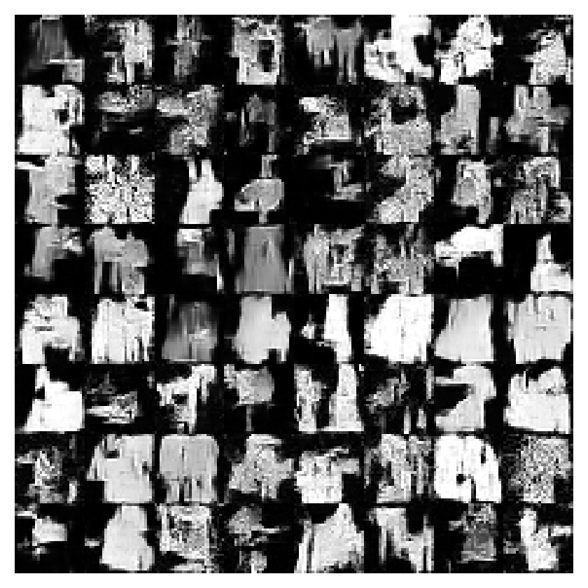

# xDiffusion

### Diffusion models, small enough to understand.

One PyTorch training loop. Eight benchmark tasks. Start with 2D points,
then use the same diffusion process to generate images.

[](https://github.com/makdoudN/xDiffusion/actions/workflows/check.yml) [](pyproject.toml) [](pyproject.toml)

**[Get started](#get-started) · [Examples](#try-an-experiment) · [Benchmarks](#a-curriculum-from-points-to-pixels) · [Code](#a-small-codebase-you-can-read) · [Results](reports/baseline-2026-10-19/README.md) · [The math](doc/companion.md)**

<table>
  <tr>
    <th>2D geometry · 55K parameters</th>
    <th>Handwritten digits · 180K parameters</th>
  </tr>
  <tr>
    <td align="center"></td>
    <td align="center"></td>
  </tr>
  <tr>
    <td align="center">Residual MLP · 1,500 training steps</td>
    <td align="center">Small U-Net · 5,000 training steps</td>
  </tr>
</table>

Actual samples from the included baseline runs, using 50-step DDIM sampling.
The ring is still blurred between modes, and some digits are malformed.
Configurations, learning curves, and sample grids are [included in the repo](reports/baseline-2026-10-19/README.md).

## Why this repo?

Diffusion is easier to understand when you can see every moving part. A 2D
scatter plot makes missing modes and blurry boundaries obvious; a small image
dataset then shows what changes when the denoiser needs spatial structure.

xDiffusion follows the spirit of [nanoGPT](https://github.com/karpathy/nanoGPT)
and [xByteGPT](https://github.com/makdoudN/xByteGPT): keep the implementation
small, make the experiment explicit, and give each abstraction a reason to exist.

- **Read the whole algorithm.** The cosine schedule, training objective, DDPM,
  and DDIM fit in [one 103-line module](src/xdiffusion/diffusion.py).
- **See what tensors mean.** Jaxtyping names shapes and dtypes; einops names axes
  when rearranging data. Tests check the annotations at runtime.
- **Change an experiment from the CLI.** Tyro turns ordinary dataclasses into
  flags such as `--model.width 64` and `--diffusion.steps 100`.
- **Compare runs with evidence.** Fixed validation noise, separate data/model
  seeds, reference baselines, checkpoint selection, and saved sample plots.

The code is intended for learning and small experiments. It uses single-device
float32 training on **CPU or CUDA**, with AdamW, gradient clipping, and EMA.

## Get started

Install [uv](https://docs.astral.sh/uv/getting-started/installation/), then:

```bash
git clone https://github.com/makdoudN/xDiffusion.git
cd xDiffusion
uv sync --locked

# Learn eight Gaussian modes. No dataset download needed.
uv run -m xdiffusion.train
```

Open **`out/ring8/samples.png`** to see generated points overlaid on validation
data. The run also saves a checkpoint, configuration, learning history, and
metrics. Training picks CUDA when available and otherwise uses CPU.

Generate a fresh sample set, then score the checkpoint on held-out test data:

```bash
uv run -m xdiffusion.sample --checkpoint out/ring8/ckpt.pt
uv run -m xdiffusion.evaluate --checkpoint out/ring8/ckpt.pt
```

These write to `out/samples/` and `out/evaluation/`, respectively. Every command
accepts `--help`. Choose a fresh `--out-dir` when training again; existing runs
are protected from accidental overwrite.

For a quick installation check on CPU:

```bash
uv run -m xdiffusion.train --device cpu --steps 20 --model.width 32 \
  --sampling.samples 64 --out-dir out/smoke
```

Twenty steps exercise the pipeline; use the longer budgets below to learn the
distributions. Python 3.12–3.13 is supported. The lockfile pairs PyTorch 2.7.1
with torchvision 0.22.1, including support for older CUDA GPUs such as the GTX 1080.

## Try an experiment

### Change the geometry

Swap the dataset while keeping the objective, optimizer, and denoiser the same:

```bash
uv run -m xdiffusion.train --data.task moons --out-dir out/moons
uv run -m xdiffusion.train --data.task checkerboard --steps 5000 \
  --out-dir out/checkerboard
```

Inspect the [moons](reports/baseline-2026-10-19/moons-seed0/samples.png) and
[checkerboard](reports/baseline-2026-10-19/checkerboard-seed0/samples.png)
baseline plots. Look for curved structure, empty regions, and boundary sharpness.

### Move from coordinates to pixels

Start with generated circles and squares, then try handwritten digits:

```bash
# Synthetic 16×16 images: stays entirely offline.
uv run -m xdiffusion.train --data.task shapes --model.width 32 \
  --batch-size 64 --lr 3e-4 --steps 5000 --out-dir out/shapes

# Download MNIST once, then reproduce the 5,000-step example above.
uv run -m xdiffusion.data --task mnist
uv run -m xdiffusion.train --data.task mnist --model.width 32 \
  --batch-size 64 --lr 3e-4 --steps 5000 --out-dir out/mnist
```

The data shape selects the denoiser: an MLP for coordinates, a U-Net for images.
The diffusion process and training loop stay the same. MNIST's full curriculum
preset is 20,000 steps; the 5,000-step example is a smaller starting experiment.

<table>
  <tr>
    <th>Generated shapes · 5,000 steps</th>
    <th>Fashion-MNIST · 1,000 steps</th>
  </tr>
  <tr>
    <td align="center"></td>
    <td align="center"></td>
  </tr>
</table>

The short Fashion-MNIST run shows coarse silhouettes and visible artifacts.
To train on it, download with `--task fashion`, then use the `fashion` benchmark
preset below. Image examples are unconditional: labels are ignored.

### Trade sampling steps for speed

The same checkpoint supports deterministic DDIM and stochastic DDPM:

```bash
# DDIM: fewer network evaluations.
uv run -m xdiffusion.sample --checkpoint out/ring8/ckpt.pt \
  --sampling.steps 20 --out-dir out/ddim20

# DDPM: use every forward noise level, 200 by default.
uv run -m xdiffusion.sample --checkpoint out/ring8/ckpt.pt \
  --sampling.sampler ddpm --sampling.steps None --out-dir out/ddpm
```

DDIM defaults to 50 reverse steps. Its path is deterministic for a fixed initial
noise tensor; change `--sampling.seed` to draw different samples. DDPM requires
all forward levels. Image clean-data estimates are clipped to [-1, 1]; point
coordinates stay unclipped. Sampling steps cannot exceed the checkpoint's
forward noise levels.

## A curriculum from points to pixels

| Task | Data | What to inspect | Denoiser | Preset steps |
|---|---|---|---|---:|
| `gaussian` | Anisotropic 2D normal | Center, scale, covariance | MLP | 1,500 |
| `ring8` | Eight narrow Gaussian modes | Mode coverage and concentration | MLP | 3,000 |
| `moons` | Two noisy curved manifolds | Nonlinear geometry | MLP | 3,000 |
| `checkerboard` | Eight occupied squares | Boundaries and empty regions | MLP | 5,000 |
| `shapes` | 16×16 circles and squares | Position, size, brightness | U-Net | 5,000 |
| `mnist` | 28×28 handwritten digits | Recognizable multimodal images | U-Net | 20,000 |
| `fashion` | 28×28 clothing | Silhouettes and texture | U-Net | 30,000 |
| `cifar10` | 32×32 color photographs | Color and natural-image structure | U-Net | 100,000 |

This is a teaching progression. Presets are starting budgets, rather than
claims of convergence or equal-compute comparisons. CIFAR-10 is a harder target
for this small U-Net; its real-data training result is still pending. Seven
other tasks have [measured GPU runs](reports/baseline-2026-10-19/README.md).

```bash
# Default offline suite: four point tasks + shapes, three model seeds each.
uv run -m xdiffusion.benchmark

# A smaller multi-seed point suite.
uv run -m xdiffusion.benchmark --tasks gaussian ring8 moons checkerboard \
  --seeds 0 1 2 --steps 1500 --out-dir out/points

# Real image datasets must be downloaded before benchmarking.
uv run -m xdiffusion.data --task fashion
uv run -m xdiffusion.data --task cifar10
uv run -m xdiffusion.benchmark --tasks mnist fashion cifar10 \
  --seeds 0 --out-dir out/images

# Inspect individual runs side by side.
uv run -m xdiffusion.compare out/points/ring8-seed0 out/points/ring8-seed1
```

The image suite also needs the MNIST download from the earlier example.
[benchmark.py](src/xdiffusion/benchmark.py) contains the complete preset table.
A different model seed changes initialization and training randomness; the
independent data seed keeps split membership fixed.

### Measured baseline

GTX 1080, float32, 1,500 training steps per point task, three model seeds.
SWD is sliced Wasserstein-1 distance; lower is better **within the same task**.
The reference column compares two independent held-out subsets.

| Task | Model SWD ↓, mean ± sd | Reference SWD | Standard-normal baseline |
|---|---:|---:|---:|
| Gaussian | **0.0229 ± 0.0025** | 0.0149 | 0.7479 |
| Ring8 | **0.1030 ± 0.0037** | 0.0538 | 0.2967 |
| Moons | **0.0530 ± 0.0041** | 0.0376 | 0.4128 |
| Checkerboard | **0.0516 ± 0.0016** | 0.0398 | 0.3291 |

[The full report](reports/baseline-2026-10-19/README.md) includes 17 runs across
seven tasks, exact configurations, image results, timing, and sample grids.
For images, SWD measures pixel-space similarity. Inspect the grids alongside
it; it does not measure perceptual quality or replace FID.

## A small codebase you can read

```text
xDiffusion/
├── src/xdiffusion/
│   ├── diffusion.py   Cosine schedule, noise objective, DDPM and DDIM
│   ├── models.py      Sinusoidal time features, residual MLP, small U-Net
│   ├── train.py       One explicit training loop, EMA, best checkpoint
│   ├── data.py        Synthetic generators, image splits, download CLI
│   ├── sample.py      Checkpoint → points or image grid
│   ├── metrics.py     Fixed-noise MSE and sliced Wasserstein distance
│   ├── evaluate.py    Held-out scores, baselines, generation timing
│   ├── benchmark.py   Task presets and sequential multi-seed runs
│   ├── compare.py     Per-run tables and aggregate statistics
│   └── common.py      Device selection, serialization, plotting
├── tests/             Equations, tensor shapes, splits, full pipeline
├── doc/companion.md   Algorithm and measurement, from first principles
├── reports/           Measured baselines and actual sample images
└── pyproject.toml     Dependencies, shape-checking tests, lint settings
```

A useful reading order is [the diffusion process](src/xdiffusion/diffusion.py),
[the two denoisers](src/xdiffusion/models.py), then
[the training loop](src/xdiffusion/train.py). Read
[the companion](doc/companion.md) alongside the code for the equations and the
point model's high-noise identity boundary.

Both denoisers implement one contract:

```python
model(noisy: Float[Tensor, "batch *shape"],
      time: Float[Tensor, "batch"]) -> Float[Tensor, "batch *shape"]
```

`time` is t/T; the output predicts the Gaussian noise added to clean data.
`shape` is `(2,)` for points or `(channels, height, width)` for images. The U-Net
has two spatial resolutions, time-conditioned residual blocks, GroupNorm, and
a skip connection. `model.depth` controls the MLP only.

To add a distribution, extend [data.py](src/xdiffusion/data.py) and add a budget
in [benchmark.py](src/xdiffusion/benchmark.py). To try a different denoiser,
preserve `(noisy, time) → noise` and update `make_model`. Keep splits and
sampling settings fixed when comparing architectures.

## What a run saves

| Artifact | Contents |
|---|---|
| `config.json` | Full configuration, data seed, and model seed |
| `history.json` | Fixed validation noise MSE and accumulated training time |
| `ckpt.pt` | Best EMA weights, configs, input shape, and selected training step |
| `summary.json` | Scores, parameter count, throughput, sampler settings, hardware and versions |
| `samples.pt` / `samples.png` | Generated tensors and a scatter plot or image grid |

Checkpoint selection uses validation noise MSE. Synthetic splits are generated
with independent fixed seeds. Image datasets reserve 5,000 official training
examples for validation; `evaluate` defaults to the untouched official test
split. Pixels are normalized to [-1, 1], without augmentation.

Noise MSE measures denoising accuracy. SWD compares 128 fixed random projections
of generated and held-out samples. The saved scores include both a held-out
reference comparison and a standard-normal baseline to put the distance in
context. Neither metric alone establishes good samples.

Training throughput excludes validation and checkpoint writes. Generation is
warmed up and synchronized on CUDA, including transfer of samples to CPU.
Compare speed on the same hardware and sampling settings. Seeds make runs
repeatable within an environment; cross-device bitwise identity is not promised.

Inference checkpoints contain no optimizer state, so training resumption is
not implemented. The project keeps its focus on small unconditional models;
DDP, latent autoencoders, guidance, learned variance, and mixed precision are
outside the current scope.

## Development

```bash
uv run pytest                     # 42 tests, with runtime shape/dtype checks
uv run ruff check .
uv run ruff format --check .
uv build
```

Jaxtyping + beartype checks tensor contracts during pytest. Normal training
runs do not enable the checking hook. GitHub Actions runs the test and lint
checks on pushes and pull requests.

## References

- [Denoising Diffusion Probabilistic Models — Ho et al.](https://arxiv.org/abs/2006.11239)
- [Improved Denoising Diffusion Probabilistic Models — Nichol & Dhariwal](https://arxiv.org/abs/2102.09672)
- [Denoising Diffusion Implicit Models — Song et al.](https://arxiv.org/abs/2010.02502)
