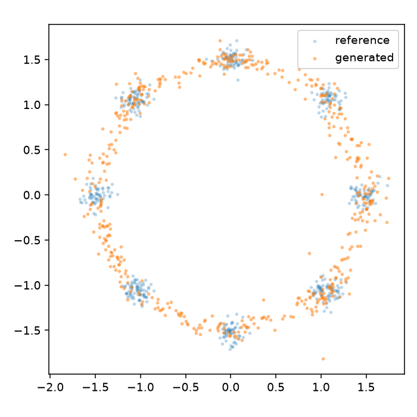
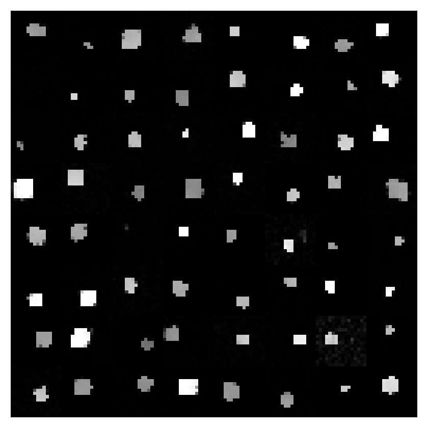
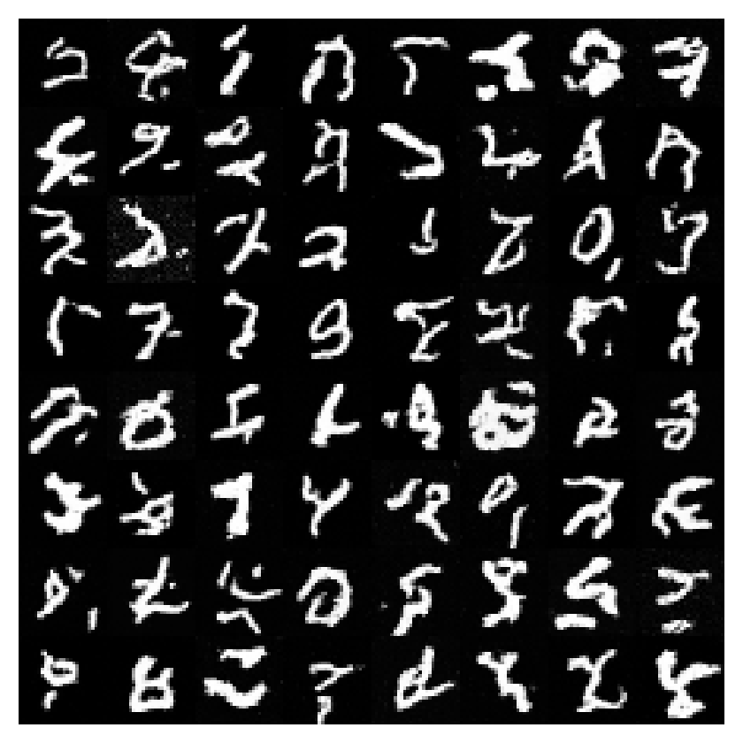

# Baseline runs · 19 October 2026

Local float32 runs on an NVIDIA GeForce GTX 1080 (8 GB), PyTorch 2.7.1+cu126,
Python 3.12.14. These are small reproducible baselines, not converged research
results. All main-table scores use **validation** data, 512 generated samples,
128 fixed unit projections, and 50-step deterministic DDIM. Data seed 1234;
sampling seed 0. Models use the EMA checkpoint with lowest validation noise MSE.

## Point distributions

1,500 optimizer steps, batch size 256, width 128, depth 3, 55,042 parameters.
Each row reports three independent model seeds (0, 1, 2); ± is sample standard
deviation. Training data and validation data are identical across those seeds.

| Task | SWD ↓, mean ± sd | Reference SWD | Standard-normal baseline |
|---|---:|---:|---:|
| Gaussian | 0.0229 ± 0.0025 | 0.0149 | 0.7479 |
| Ring8 | 0.1030 ± 0.0037 | 0.0538 | 0.2967 |
| Moons | 0.0530 ± 0.0041 | 0.0376 | 0.4128 |
| Checkerboard | 0.0516 ± 0.0016 | 0.0398 | 0.3291 |

Every run improves on the standard-normal baseline. Ring8 still spreads mass
between the target modes; a low projection distance does not establish perfect
mode concentration or coverage. The reference score exposes finite-sample
variation; it is not a strict lower bound.



## Image diagnostics

The short runs use batch size 64, U-Net width 32, 179,969 parameters, and one
model seed (0). Shapes and MNIST also have longer runs below. SWD is measured
in **pixel space**, so it does not establish perceptual or semantic quality.
The 1,000-step grids have conspicuous artifacts and malformed examples.

| Task | Steps | Noise MSE | Pixel SWD ↓ | Reference SWD | Normal baseline |
|---|---:|---:|---:|---:|---:|
| fashion | 1,000 | 0.0923 | 0.2193 | 0.0371 | 0.6224 |
| mnist | 1,000 | 0.0549 | 0.2754 | 0.0377 | 0.7801 |
| mnist | 5,000 | 0.0418 | 0.0901 | 0.0377 | 0.7801 |
| shapes | 1,000 | 0.0342 | 0.1874 | 0.0259 | 0.9442 |
| shapes | 5,000 | 0.0169 | 0.0345 | 0.0259 | 0.9442 |





CIFAR-10 is implemented and covered by RGB forward/backward and dataset-loader
tests. Its original dataset host downloaded too slowly during verification;
the download was stopped, so there is **no measured CIFAR-10 training result**.
MNIST and Fashion-MNIST used the real downloaded datasets.

## Reproduce

These archived runs use [revision 0ca489a](https://github.com/makdoudN/xDiffusion/tree/0ca489a).
The current image backbone is larger. Use a separate checkout of that revision
to reproduce the original architectures and defaults:

```bash
git worktree add ../xDiffusion-baseline 0ca489a
cd ../xDiffusion-baseline
uv sync --locked
uv run -m xdiffusion.benchmark --tasks gaussian ring8 moons checkerboard \
  --seeds 0 1 2 --steps 1500 --out-dir out/points

uv run -m xdiffusion.data --task mnist
uv run -m xdiffusion.data --task fashion
uv run -m xdiffusion.benchmark --tasks shapes mnist fashion \
  --seeds 0 --steps 1000 --out-dir out/images
uv run -m xdiffusion.benchmark --tasks shapes mnist \
  --seeds 0 --steps 5000 --out-dir out/longer-images
```

The benchmark's per-task learning rates and architecture settings come from
`benchmark.py`; every archived run also has its complete `config.json`. The
5,000-step MNIST run is still shorter than its 20,000-step curriculum preset.
Because learning-rate decay depends on the requested budget, the longer runs
are fresh experiments, not continuations of the 1,000-step runs.

## Additional checks

- CPU pytest: **42 passed**, with runtime jaxtyping + beartype checks enabled.
- Ruff lint and formatting checks pass; wheel and source distribution build.
- Train → checkpoint → sample → held-out evaluation tested for points and images.
- Actual CUDA training performed on all seven reported tasks.
- Full 200-step DDPM evaluated on held-out ring8 test data: SWD **0.0950**,
  noise MSE **0.4134**; see [raw evaluation](ring8-test-ddpm/evaluation.json).
- The 1,000-step MNIST checkpoint evaluated on the official test split: SWD
  **0.2893**, noise MSE **0.0552**; see [raw evaluation](mnist-test/evaluation.json).
- The 20-step DDIM sampling CLI was also exercised on the ring8 checkpoint.

Test results use different splits or samplers from the main tables and should
be read separately. The test evaluations were not used for checkpoint selection.

## Artifacts

[results.json](results.json) preserves per-run metrics, timing, and hardware.
Each run directory preserves its config, learning history, and summary. Seed-0
sample PNGs are included. Checkpoints and full sample tensors remain in local
`out/` rather than in Git. [source-sha256.json](source-sha256.json) identifies
the implementation and dependency lock used for these baselines.

Other point plots: [Gaussian](gaussian-seed0/samples.png),
[moons](moons-seed0/samples.png), [checkerboard](checkerboard-seed0/samples.png).
Short image plots: [shapes](shapes-seed0/samples.png),
[MNIST](mnist-seed0/samples.png), [Fashion-MNIST](fashion-seed0/samples.png).
