# Generative-family comparison · 20 October 2026

## Protocol

MNIST: one training seed (0), 10,000 updates, batch 64, final EMA weights.
Priming counts both stages: 5,000 reconstruction and 5,000 distributional
updates. The common evaluation uses 1,024 generated images, validation data,
sampling seed 0, and an independent frozen MNIST classifier. The data seed is
1234. Diffusion in this matched-budget table uses epsilon prediction.

The real-vs-real feature distance is 14.14.
Feature distance is dataset-specific, **not Inception FID**. Confidence is a
95%-softmax diagnostic, **not generated-image accuracy**. No image is filtered
or chosen by score: every grid starts at the first generated sample.

| Family | Feature distance ↓ | Confident fraction | Pixel SWD ↓ | NFE | Train seconds |
|---|---:|---:|---:|---:|---:|
| diffusion | 45.59 | 75.6% | 0.0374 | 50 | 265.1 |
| flow | 30.30 | 81.4% | 0.0296 | 50 | 258.8 |
| priming | 29.30 | 75.7% | 0.0355 | 1 | 311.7 |
| vae | 402.08 | 37.9% | 0.0966 | 1 | 37.6 |
| gan | 99.91 | 60.3% | 0.0357 | 1 | 47.2 |

These are exploratory baselines, not a statistically established ranking.
Architecture sizes and extra networks differ. Priming uses supervised frozen
features and an additional encoder-training stage. GAN trains a discriminator;
VAE trains an encoder. Equal updates do not imply equal compute. Exact costs,
model sizes, class histograms, and configurations are in [results.json](results.json)
and the per-run folders. The GAN baseline retains a constant discriminator LR
while its generator LR decays, as recorded by the implementation.

## Qualitative comparison

### Diffusion · 10,000 updates

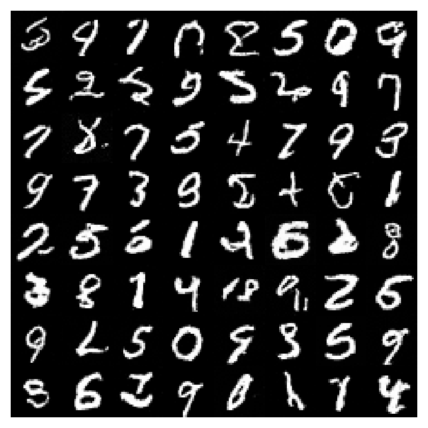

### Flow · 10,000 updates

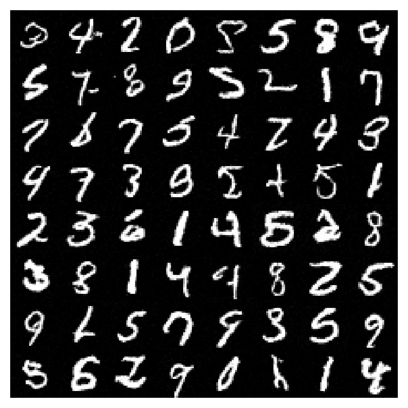

### Priming · 10,000 updates

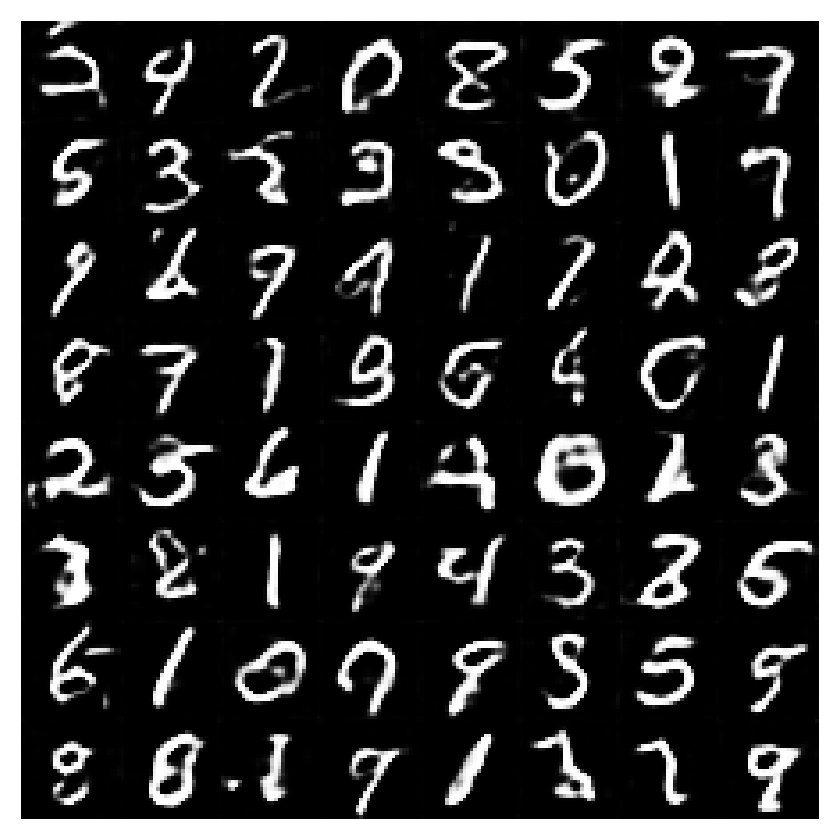

### VAE · 10,000 updates

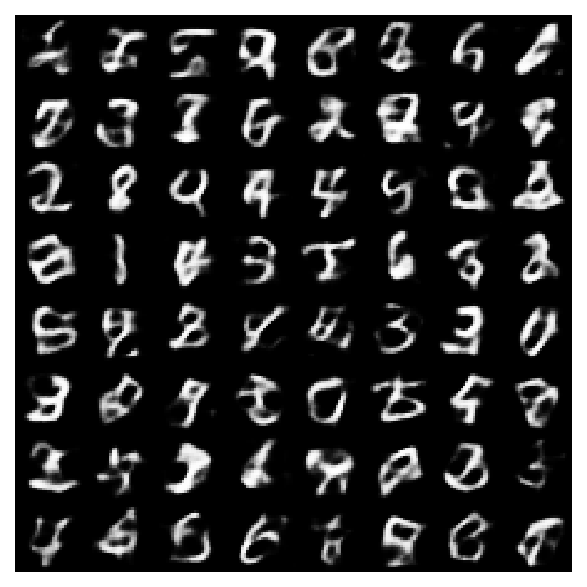

### GAN · 10,000 updates

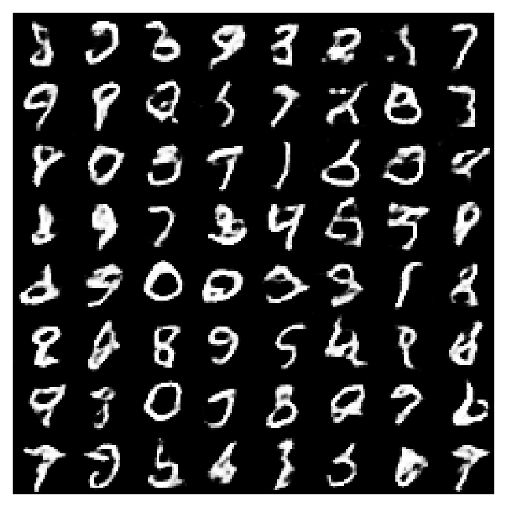

## Quality investigation

The original 5,000-step tiny diffusion model had feature distance 287.54 and
42.8% confident samples. Keeping its weights fixed, 200-step DDIM reached
44.1%, and 200-step DDPM reached 45.3%; changing the sampler did little.
Training that same tiny architecture for 20,000 updates reached 49.0%.
See [the sampler controls](sampler-ablation/results.json) and
[the longer tiny run](tiny20k-quality.json).

The larger three-resolution backbone improves context and capacity. In the
10,000-step controlled parameterization comparison, epsilon and v prediction
share the same backbone, budget, data, and optimizer recipe. Neither initial
run reached the predeclared 90% confidence diagnostic. The larger 50,000-step
v run therefore tests additional training; it is **outside** the fixed-budget
family comparison and must not be used to claim a matched-budget win.

| Same backbone and 10,000-update budget | Feature distance ↓ | Confident fraction |
|---|---:|---:|
| Epsilon prediction | 45.59 | 75.6% |
| V prediction | 33.84 | 80.9% |

### Additional quality run · v prediction, 50,000 updates

Feature distance **27.53**, confidence diagnostic **87.6%**, pixel SWD **0.0296**.

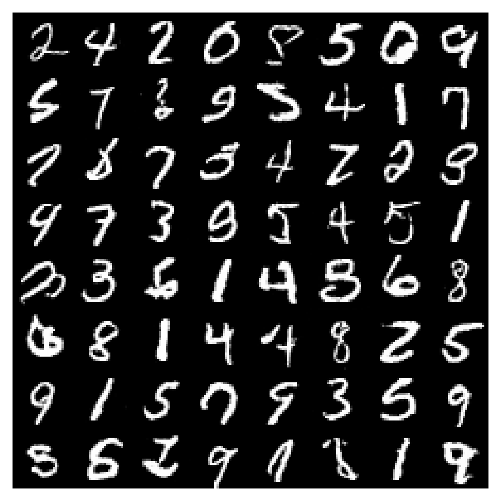

**The quality target was not reached.** On the fixed first 512 samples, the 50,000-update run scores 89.1%, below the 90% target. [quality-gate.json](quality-gate.json) retains `passed: false`; the standalone quality-check command exits nonzero. The 1,024-sample scores above use a different sample count and must not be substituted for this check.

Further probes also missed the target: 200-step DDIM reached 89.6%, 200-step DDPM 88.3%, and online weights with 200-step DDIM 87.7%. A separate 5,000-update warm start from the 50k EMA, with a fresh optimizer at LR 3e-5, reached 86.9% (55,000 total updates). These are diagnostics on the same validation protocol, not independent test results. Their [configs and grids](ablations/) remain available; the main gallery keeps the original final 50k EMA and its default sampler. Visual inspection finds much clearer strokes than the original tiny model, but still malformed and ambiguous digits. None of these runs is a claim of solved image generation.

## Reconstruction and denoising

Adjacent VAE images are original test inputs followed by posterior-mean
reconstructions. The generation table above instead uses fresh prior latents.
The full VAE reconstruction evaluation covers 1,024 test inputs;
[vae-test.json](vae-test.json) records counts and errors. The 16-image panels
below are illustrative and their pixel errors are not a cross-family ranking:
VAE compression, diffusion denoising at t/T=0.25, and Priming denoising at s=0.8
have different input information and objectives. GAN has no encoder. A flow
ODE cycle would test numerical inversion, not learned reconstruction quality.

On those 1,024 inputs, VAE reconstruction MSE is **0.006458** on [0,1] pixels.
The independent judge predicts the true label for **97.0%** of reconstructions,
versus **98.4%** of original inputs. These are reconstruction diagnostics;
the much weaker VAE prior generations remain visible above.

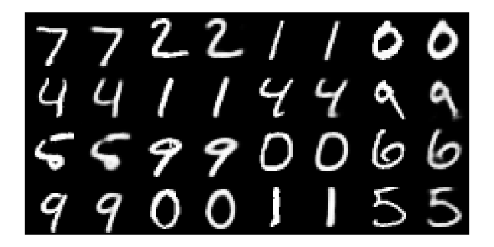

Diffusion panel order: original, noisy input, clean prediction.

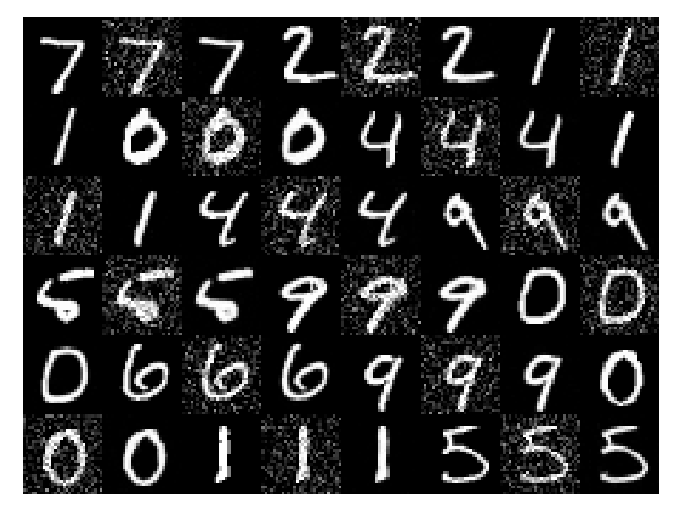

Priming panel order: original, corrupted input, reconstruction-only output,
post-trained output. Post-training optimizes a distribution, not paired MSE.

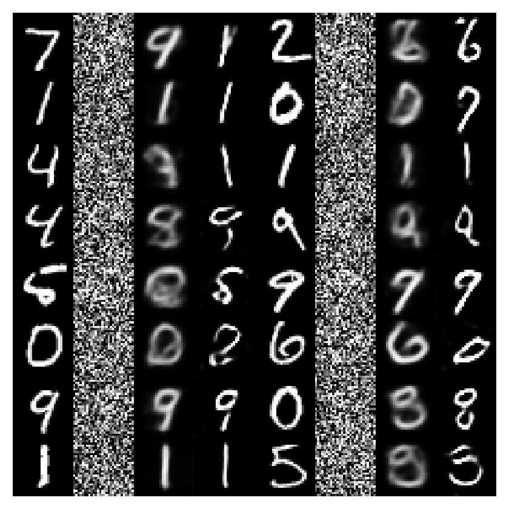

## Priming stage ablation

Both stages below use the same 512 CPU-generated noise tensors, seed 0, and
independent evaluation features. See [raw stage scores](priming-stages/stages.json).
These scores have a different sampling count/device from the main table.
Reconstruction priming alone does not produce a good one-step generator.

| Stage | Feature distance ↓ | Confident fraction |
|---|---:|---:|
| Reconstruction priming | 818.60 | 36.1% |
| Distributional post-training | 51.23 | 75.6% |

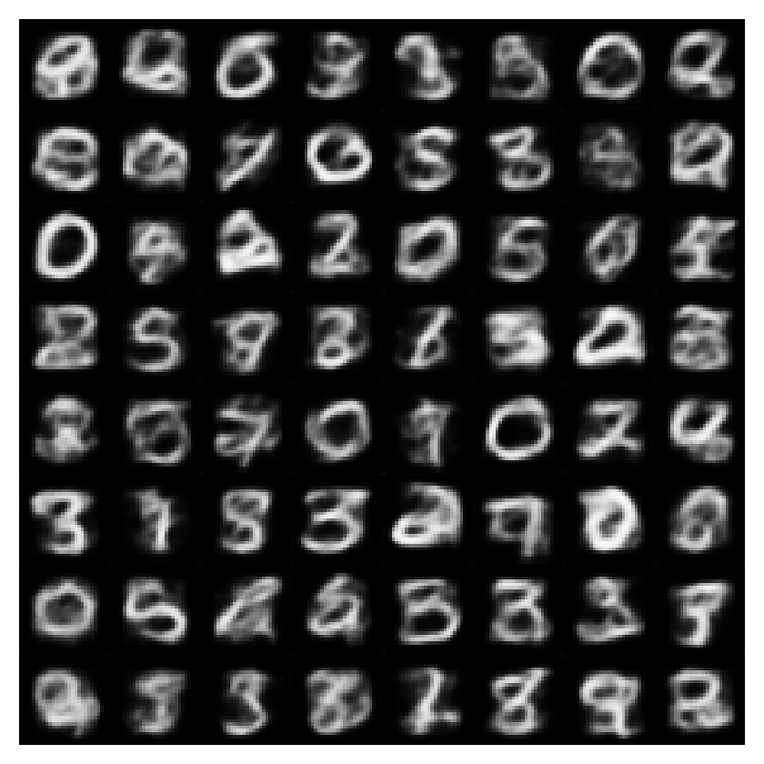

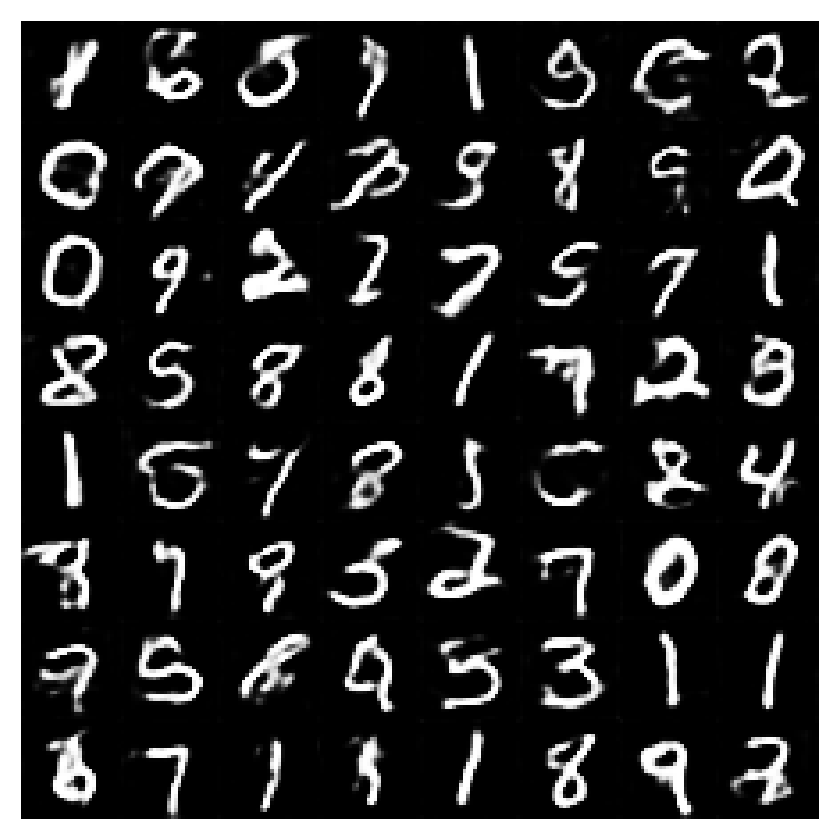

## Ring8: concentration and coverage

Three independent training seeds, 5,000 updates and batch 256 per family.
A point is near a mode when it is within 0.24 of a true center; a mode is
covered if at least 1% of all generated points land near it. Counts avoid
mistaking a continuous blurry ring for eight concentrated modes.

| Family | SWD ↓, mean ± sd | Within a mode, mean | Modes covered, min / 8 |
|---|---:|---:|---:|
| diffusion | 0.0756 ± 0.0048 | 92.4% | 8 |
| flow | 0.0794 ± 0.0023 | 91.4% | 8 |
| priming | 0.1102 ± 0.0019 | 35.6% | 8 |
| vae | 0.1618 ± 0.0049 | 22.9% | 8 |
| gan | 0.2710 ± 0.0267 | 55.8% | 8 |

## Reproduce

```bash
uv sync --locked
uv run -m xdiffusion.data --task mnist
uv run -m xdiffusion.study --tasks mnist --steps 10000 \
  --encoder-root reports/comparison-2026-10-20/encoders --out-dir out/comparison-mnist
uv run -m xdiffusion.experiment --family diffusion --prediction v --steps 10000 \
  --encoder-dir reports/comparison-2026-10-20/encoders/mnist --out-dir out/quality-ablation/v10k
uv run -m xdiffusion.experiment --family diffusion --prediction v --steps 50000 \
  --encoder-dir reports/comparison-2026-10-20/encoders/mnist --out-dir out/quality-ablation/v50k
uv run scripts/check_image_quality.py --samples out/quality-ablation/v50k/samples.pt \
  --judge reports/comparison-2026-10-20/encoders/mnist/judge.pt
# Expected: this diagnostic fails its 90% target. Continue the other commands separately.
uv run -m xdiffusion.experiment --family diffusion --prediction v --steps 5000 --lr 3e-5 \
  --init-checkpoint out/quality-ablation/v50k/ckpt.pt \
  --encoder-dir reports/comparison-2026-10-20/encoders/mnist --out-dir out/quality-ablation/v55k
uv run -m xdiffusion.study --tasks ring8 --seeds 0 1 2 --steps 5000 \
  --width 128 --batch-size 256 --out-dir out/comparison-ring8
```

The standalone experiment command defaults to encoders under `out/encoders`;
the commands above explicitly use the included frozen encoders. To train new
ones, use `python -m xdiffusion.quality`. Encoder
metadata records its training and data seeds and held-out classification score.
Generator checkpoints and optimizer states remain under local `out/`; the repo
includes their configurations, learning histories, summaries, and sample grids.
[source-sha256.json](source-sha256.json) identifies the implementation shipped
with this report. Training is float32 on a GTX 1080. Timings depend on hardware
and system load; seed identity across different devices is not promised.
